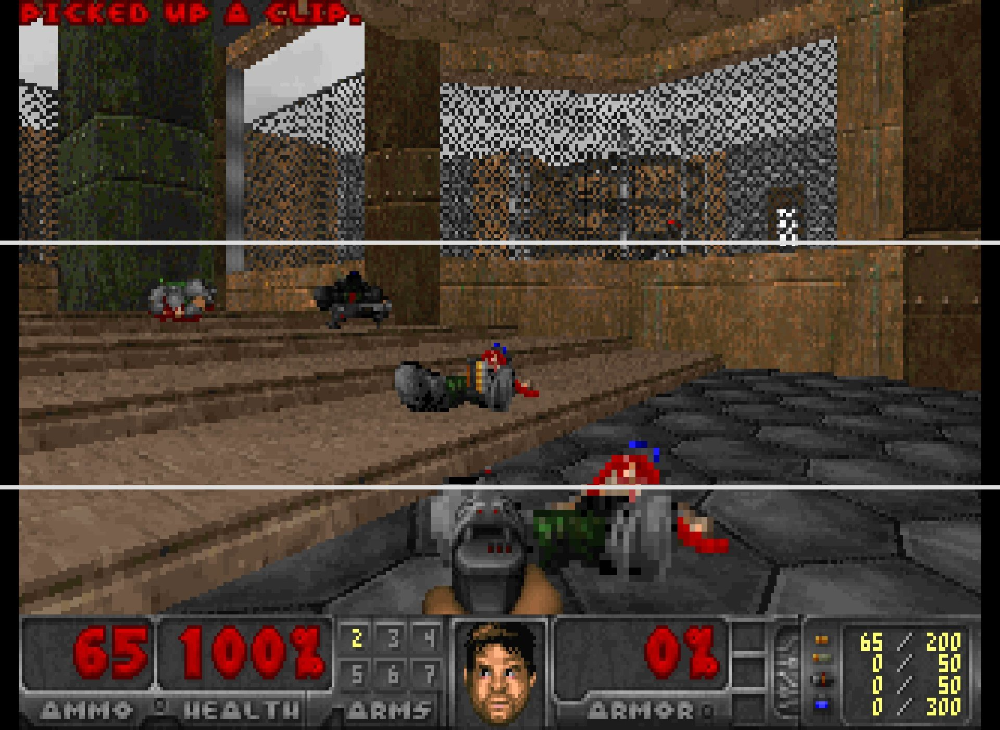

# kiosko-plugin-doom

Doom on your panel. For now, one interlude: the game's own attract loop (title
screens and recorded demos), with no one at the controls.

A plugin for [Kiosko](https://github.com/kiosko-lcd/kiosko), the widget mosaic
for small USB LCD panels. **Optional:** Kiosko doesn't install it; it offers it
on the Plugins page.


## Install

In Kiosko, **Plugins → Official plugins not installed → kiosko-plugin-doom → Add**.
Or from a terminal:

```sh
npm install --prefix ~/.config/kiosko/plugins kiosko-plugin-doom
```

(macOS: `~/Library/Application Support/Kiosko/plugins`, Windows: `%APPDATA%\Kiosko\plugins`.)

Then add the interlude to a screen: **Screens → Interludes → Doom demos**. Like
any interlude it plays at a time slot (every 15 min = at :00, :15, :30, :45)
for up to `maxSeconds`, or right away from the editor or Home Assistant.

## The game's data

- **Freedoom by default.** [Freedoom](https://freedoom.github.io) Phase 1 is
  free content (new levels, art and demos, under the BSD licence). The first
  time the interlude is due it downloads `freedoom-0.13.0.zip` (24 MB) from
  GitHub into the plugin's data folder, checks it against the release's
  published SHA-256 and keeps `freedoom1.wad` and its licence. That time it
  doesn't play; from the next one on it does.
- **Your own IWAD.** Point the `wad` option at a file you own (`doom1.wad`
  from the shareware, `DOOM.WAD`, `DOOM2.WAD`…). It is read where it is;
  nothing is copied, and nothing from id Software is shipped or downloaded.

## What it does on your machine

- **Runs** `node`: the engine runs in a process of its own, started with the
  same Node as Kiosko, one per interlude playing. It stops when the interlude
  ends (or 10 s after the last frame, when an interlude is cut short).
- **Contacts** `github.com` and `release-assets.githubusercontent.com`, once,
  to download Freedoom (only when `wad` is empty).
- **Reads** the IWAD you name in `wad`.

About 5 % of one core while it plays at 15 fps, besides what Kiosko spends
sending the frames.

## Interludes

### Doom demos — `doom/attract`

The game plays its own recorded demos between title screens, with no one at
the controls. The game (320×200, shown at 4:3) is centred on the panel. On a
wide one, the game's numbers go beside it in the panel's theme: the map, the
level's time, kills, items and secrets on the left; health, armour, the
weapon and its ammo on the right.

| Option | Type | Default | |
|---|---|---|---|
| `wad` | path | `""` | IWAD. A game data file of your own (doom1.wad, DOOM.WAD, DOOM2.WAD…). Empty: Freedoom. |
| `panels` | integer 1–3 | `1` | Panels stacked one on top of the other that show one game between them. |
| `row` | integer 1–3 | `1` | Which of the stacked panels this screen is: 1 is the top one. |
| `showStats` | boolean | `true` | The game's numbers beside it, when each side has at least 220 px (not in a stack). |

#### Three panels, one game

Three 1920×462 bars stacked are 1920×1386, nearly the game's 4:3. Give each
of the three screens this interlude at the same times, with `panels: 3` and
its `row` (1 at the top): they play one game between them, from one engine
and one clock, each painting its third.



Screens playing the same WAD at the same time always share the game, stacked
or not: one engine for all of them.

## Playing it

With Kiosko 0.2.7 or later the editor has a **Play** page: pick the screen
with this interlude and press Play. A game of your own starts at the first
level (Hurt me plenty) on that whole screen, and you play it with the
keyboard, a game controller or, on a phone, the pad on the page:

| Pad | Keyboard | Doom |
|---|---|---|
| ▲ ▼ ◀ ▶ | arrows, W S | walk, turn |
| A | Space, Ctrl | fire |
| B | E, F | use (doors, switches) |
| L R | A D, Q | strafe |
| Y | Shift | run |
| X | Enter | choose in the menu |
| Menu | Esc | the menu |
| Map | Tab, M | the map |

It ends after a minute without a button, or with Stop.

## How it works

- `engine/`: [doomgeneric](https://github.com/ozkl/doomgeneric) (the Doom
  source, made portable) and `kiosko.c`, the platform layer for Kiosko,
  compiled to WebAssembly with Emscripten (`npm run build:engine`, in Docker;
  the result, `engine/build/doom.mjs`, is committed). See
  [engine/README.md](engine/README.md).
- `src/engine-child.ts`: the engine's process. It owns no clock: Kiosko says
  what time it is and asks for a frame.
- `src/engine.ts`: Kiosko's side. Forks the process and speaks
  `src/protocol.ts` with it, nothing else.
- `src/index.ts`: the interlude. Game time is wall time, so when the panel
  can't keep up the game skips frames rather than going slow.

## Licence

GPL-2.0-or-later, like the engine it is built on (see [LICENSE](LICENSE)).
Kiosko itself is MIT; this plugin is a separate program, installed only if you
choose to, and its engine runs in its own process.

Freedoom is © the Freedoom contributors, BSD licence (downloaded with its
`COPYING.txt`). DOOM is a trademark of id Software / ZeniMax Media; this
project is not affiliated with or endorsed by them.
